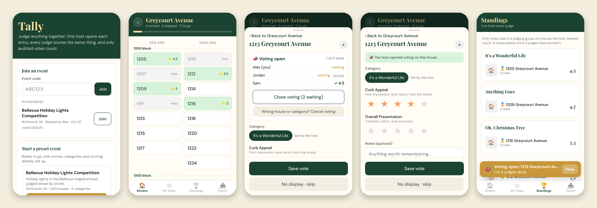
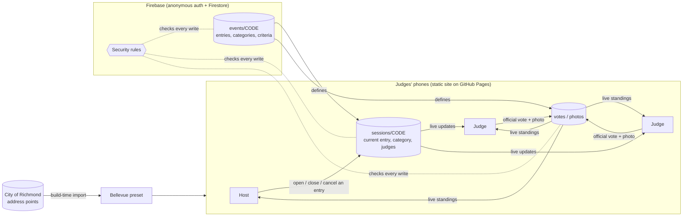

# Tally

**Organized judging for loosely organized groups.** Tally is a mobile web app for host-led group judging. A host opens voting on one entry at a time. Every judge's phone jumps to that entry with the same category and criteria, scores sync live, and the results count only votes that pass a server-enforced audit.

Start a preset event, join one in progress, or create your own: any judged competition with entries, categories, and things to score. The first preset is the **Bellevue Holiday Lights Competition** in Richmond, Virginia, where judges walk the neighborhood and score houses street by street.

**[Open the live app →](https://daviskrebs.github.io/quorum/)**



## The problem

The Bellevue neighborhood in Richmond, Virginia runs a yearly holiday lights competition with four categories. A panel of volunteer judges goes street by street, and every house has to be scored by the same people, in the same category, on the same scale. The first version of this app ran into three problems:

- **Wrong house numbers.** It generated numbers from guessed ranges, so judges were shown houses that don't exist and missed ones that do.
- **No coordination.** Each judge picked houses and categories alone, so scores didn't line up.
- **No way to combine votes.** Votes lived on each phone and had to be emailed around as spreadsheets.

## What it does

- **Any event.** The landing page lists events in progress and presets, and has a form for creating a new event: entries (optionally grouped into sections), categories, scoring criteria, and how many judges an entry needs. Each event gets a six-letter code and a share link.
- **Real addresses, organized like the street.** Houses come from the City of Richmond's official address records. They're grouped by block, with odd and even sides side by side, the way you'd walk the street.
- **Host-led rounds.** The host picks a house and its category, then opens voting. Every judge's phone opens to that house with the category locked. The host sees who has scored, who skipped, and who's still deciding, and closes voting when everyone's done.
- **Built for a real night out.** Judges can join late, leave, and rejoin in one tap. The host can hand off the role, or a judge can take over if the host's phone dies. A house opened by mistake can be cancelled. Phones that lose signal keep working and catch up when they reconnect.
- **Audited results.** A vote counts only if it was cast in a group on a house the host opened, and a house places only after three judges have scored it. Everything else is listed under "Not counted," so the results can be checked.
- **Photos and export.** Judges can attach a photo to each vote. Photos open full size, and the winners' photos download as a single .zip. All votes export to CSV, including audit fields.

## How it works



- **Events as data.** An event record holds the layout, wording, categories, criteria, entries, and judge minimum. Groups, votes, and photos live under their event, and the judging app reads everything from the event it's opened on. Presets keep large entry lists (like Bellevue's 1,243 houses) in code, so their event records stay small.
- **No build step for the app.** The app is plain HTML, CSS, and JavaScript. The Firebase SDK is bundled once into `vendor/firebase.js`. GitHub Pages serves the files as they are.
- **Firestore with an offline cache.** Writes apply on the phone immediately and sync in the background, and live listeners push votes, standings, and the current house to every phone.
- **Anonymous sign-in.** Judges never create accounts. Each phone gets a stable anonymous identity, which the security rules use to decide who can write what.

## Engineering highlights

**Address data from city GIS** ([`scripts/build-addresses.mjs`](scripts/build-addresses.mjs))
- The importer queries Richmond's ArcGIS address layer for the neighborhood's streets. It drops apartment units and handles half addresses (`1313½`) and letter suffixes, without mistaking street directions like the "W" in "1205 W Laburnum Ave" for suffixes.
- Instead of hand-entered number ranges, it traces the neighborhood outline from the address points of the four boundary streets and keeps only points inside it.
- On boundary streets only the Bellevue side is judged. The importer works out whether that side is the odd or even numbers by comparing the map coordinates of neighboring houses. Every pair agreed.
- Result: 1,243 houses on 27 streets, including 10 streets the original hand-made list had missed.

**Votes the database can vouch for** ([`firestore.rules`](firestore.rules))
- Scores are checked against the vote's own event: the category must be one of the event's categories, and every score must be 1 to 5 stars for a criterion the event defines.
- A vote is official only if it carries the group code and the ID of the house the host opened. The rules accept it only while that exact house is open, in the host's category, from a judge in the group.
- Official votes lock when voting closes. Votes from a cancelled opening are voided and can be re-cast.
- Only the host can open or close entries, and only an event's organizer can end it. A judge can take over hosting, but that write can't touch anything else. Ended groups can't be reopened.
- Standings apply the 3-judge minimum on top. The CSV keeps `official`, `sessionCode`, and `callId` for each vote.

**Photos within Firestore's limits**
- Photos are resized on the phone to 1,600 px. JPEG quality steps down only as far as needed to stay under Firestore's 1 MB document limit, which keeps the project on the free plan without Cloud Storage.
- The .zip download is built in the browser by a small dependency-free zip writer (stored entries plus CRC-32).

## Tests

```sh
npm install
npm test          # starts the Firebase emulators, then runs the end-to-end suite
```

[`tests/e2e.test.mjs`](tests/e2e.test.mjs) drives several simulated phones with Playwright against the local Firebase emulators, using the real security rules. It covers:

- The landing page: events in progress, joining by code, and a warning before starting a second copy of a preset.
- A new event created from the form, judged on its own entries, categories, and criteria, then ended by its organizer.
- Live rounds: the host's category locks on judges' phones, and the host panel shows each judge's status.
- One open house at a time.
- The 3-judge minimum and the "Not counted" audit list.
- Locked votes after close, and the rules rejecting forged, impersonated, and out-of-range writes, scores for criteria the event doesn't have, and ending someone else's event.
- Cancelling a house opened by mistake and re-voting.
- Leaving and rejoining in one tap, and ending a group.
- Handing off and taking over hosting.

The emulators need Java.

## Run it yourself

1. Serve the folder with any static server, for example `npx serve .`.
2. To sync between phones, create a Firebase project. Turn on **Anonymous** sign-in and **Firestore**, paste the web app config into [`firebase.config.js`](firebase.config.js), and publish [`firestore.rules`](firestore.rules). With the config set to `null`, the app runs on a single phone and exports CSVs.
3. To refresh Bellevue's address list, run `npm run build:addresses`. To clear test data off every phone before a real event, bump `PHONE_DATA_VERSION` in [`landing.js`](landing.js).
4. To add a preset, add it to [`templates.js`](templates.js). The file describes the event shape.

| Path | What it is |
|---|---|
| `index.html` | Markup and styles for the landing page and the judging app |
| `landing.js` | Landing page: events in progress, presets, create-an-event form; loads an event |
| `app.js` | The judging app for one event: sections, scoring, groups, standings, photos, export |
| `sync.js` | Firestore sync: events, votes, photos, groups, host controls |
| `firestore.rules` | Server-side permissions and vote audit |
| `templates.js` | Preset events |
| `templates/bellevue/` | Bellevue's streets, boundary sides, and generated house list |
| `scripts/` | Address importer and Firebase SDK bundler |
| `tests/` | End-to-end tests and the emulator test server |

## What's next

- **Editing an event** after it's created (entries, categories, criteria).
- **Invite-only judges**, with an organizer approving who can vote.
- **Results hidden until published**, so standings don't sway judges mid-event.
- **Criteria per category** for created events (presets already support this, e.g. Bellevue's Unique Design applies only to Anything Goes).

## Tech

HTML, CSS, and JavaScript with no framework · Firebase Authentication and Cloud Firestore · ArcGIS REST · GitHub Pages · Playwright and Node's test runner · esbuild (SDK bundle only)

## Credits

Built by [@daviskrebs](https://github.com/daviskrebs), with [Claude Code](https://claude.com/claude-code) as a pair programmer. Address data: City of Richmond, VA.
